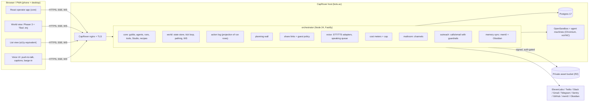

# bots.ac design

Date: 2026-10-13. Owner: Dani Roxberry. Status: approved interview decisions, ready for planning.
Supersedes: no earlier PLAN.md or design draft existed in `/workspace/bots-ac-plan/`; this is the first.
Inputs: `gather-reverse-engineering.md`, `/workspace/reports/2026-10-13-guilds-run-research.md`, `/workspace/reports/2026-10-12-ai-phone-call-consent.md`, `/workspace/bots-ac-maps/SUGGESTIONS.md`, and the repo at `droxey/bots.ac@ca45b04` (cloned read-only to `/workspace/bots-ac-plan/repo`).

## 0. Why
Today Dani's Grok Bot fleet (about 38 bots) is all text. To find out what each bot is doing, who handed what to whom, and what is stuck, she has to read walls of chat and logs. A bot busy with a long job stops answering. Handoffs can't be seen until something breaks. None of this is easy to show a seminar class.

bots.ac turns the fleet into a living pixel office she can see, talk to and share. Each pain maps to features:
- **Can't see what bots are doing:** always-animated avatars, status taken from real activity, a live action log.
- **Can't see who talks to whom:** a handoff shows as one bot walking to another with speech bubbles; meeting rooms.
- **Can't see what's stuck:** a blocked bot walks over to her with a chime and sends a push; repo rooms show alerts as cracks and errors as fires.
- **Bots get bogged down:** a fast conversation loop, with long work handed to subagent helpers (§6A).
- **Walls of text:** voice with captions, the planning wall, search that jumps to the spot on the map, a return summary card.
- **Hard to teach with:** share links, presenter view, replay.

Every section below traces back to one of these pains.

## 1. Goal

bots.ac is a visual, voice-first front end for a team of AI bots, built on the Guilds.run core. Bots live on a 16-bit top-down pixel map (Gather.town style). Each bot has an avatar that is always animated. You talk to a bot by walking up to it or tapping it. Rooms hold group conversations, repositories, planning walls, memory and outreach. It is a personal educational project for Dani's AI seminar. It runs on her CapRover server at https://bots.ac and has to work equally well on a phone and on desktop.

### Non-goals
- Real human video or WebRTC media between people. Voice is between a human and bots.
- A public multi-tenant SaaS. There is one operator (Dani) plus guests and students joined by link.
- Syncing cards to GitHub Issues or Reminders. Cards live only in bots.ac.
- An in-app map editor in the MVP. Maps are authored in Tiled.
- Redistributing LimeZu or other paid art in the public repo.

### Success criteria
- Every Guilds.run feature (section 4) is reachable, either in the world or in the list view.
- On a mid-range phone (for example a Pixel 6a or iPhone 12), the map holds 60 fps with 12 or more animated bots on screen.
- Every voice exchange has captions and a text transcript.
- Every map action has a list-view equivalent that meets WCAG 2.2 AA.
- Opening a repo room shows live bot work before anything else.

## 2. Approach

Three options were considered.

1. **Fork and extend core in place, additively (chosen).** New code goes in new directories (`apps/orchestrator/src/world/…`, `apps/web/src/features/world/…`, `packages/world-*`). Edits to existing core files are kept to a small set of hook points: composition, routes, and the run-event bus. Pros: one repo, simple CapRover build, full access to the run and tool data. Con: upstream merges need care. Mitigation: a short `UPSTREAM.md` list of touched core files and a monthly merge task.
2. Build an upstream-style "edition" repo with core as a submodule. Cleanest boundary, but the repo is already a fork, and the world needs hooks (live run events, action log) that core's exports don't expose yet. Revisit later. Several pieces (passkey `IdentityProvider`, `BlobStore`, routes) are written to the extension interfaces anyway, so a later move stays cheap.
3. WorkAdventure as the world layer. It brings a heavy platform built around human WebRTC, and bot-driven avatars don't fit it. Rejected.

## 3. Architecture

Key decisions:
- **The server is authoritative; the client only renders.** The world service holds each bot's position, animation state, status and room. It runs a 10 Hz tick for movement and emits deltas over one WebSocket per client. The client interpolates to 60 fps. Bot movement is driven by run events: a tool call becomes "walk to the tool object", a handoff becomes "walk to the other bot", a card move becomes "walk to the wall". Pathing is A* on the Tiled collision layer, run on the server (easystar.js).
- **Avatars are always animated.** Each avatar is a sprite sheet with `idle|walk|talk-<dir>` rows. The renderer never shows a static frame. With reduced motion on, the walk tween becomes a short fade-teleport and the idle loop slows to half speed with less amplitude. It is never frozen.
- **The action log is a projection, not a new source of truth.** Core already stores each run's prompt, steps, tool calls and memory diffs. `action_log` adds a flat, timestamped, indexed view (tool call, file change, message, handoff, card move, call, cost), with links back to `?run=&call=`. Replay on the map re-emits these events into a sandboxed world instance.
- **Layered settings.** Every tunable (model, voice, memory backend, sandbox size, STT/TTS provider, channel) resolves in this order: global default < feature < bot < task. All features are on by default. The UI shows each value's source ("inherited from bot").
- **Adapters everywhere.** `VoiceProvider` (ElevenLabs default, browser Web Speech fallback), `TelephonyProvider` (Twilio, ElevenLabs Agents), `MemoryStore` (mem0 plus Obsidian dual-write), `ChannelAdapter` (Slack, Gmail, SMS/WhatsApp via Twilio, Telegram), `AssetSource` (R2, local volume), `Notifier` (Web Push). Each one has a fake implementation for tests.

### Deployment (CapRover kept)
- The CapRover app `bots-ac` runs the orchestrator image, built from the repo by `captain-definition`. Postgres is a CapRover one-click app with a persistent volume.
- OpenSandbox needs the host Docker socket and host-path parity for workspaces. It runs as a second CapRover app with a Service Update Override that mounts `STATE_ROOT` at the same absolute path and reaches Docker only through a socket proxy limited to container ops (no raw `docker.sock`; Dani, 2026-10-16). A setting `untrustedWorkProvider=agent37` sends untrusted work to Agent 37 instead. bots.ac runs on its own host (Servarica Montreal CapRover), separate from the Grok Bot box. It is not exposed publicly. The research rates this "workable but awkward", so it is the first spike in Phase 0.
- Core has no auth. Before the domain goes public, passkey auth (WebAuthn) ships as an `IdentityProvider`, and `compat-cookie` mode is disabled in production.
- Secrets live in 1Password. A small `op inject` deploy script writes them into CapRover env vars, and they are never committed. (Org model keys still live in core's encrypted secret store.)
- Backups: a nightly `pg_dump` plus a tar of `STATE_ROOT/attachments`, encrypted with age, pushed to an off-server R2 bucket, with 30 nightly and 12 monthly copies kept. A one-click export zips rooms, cards, the action log and memory as JSON plus Markdown.

### Private art
LimeZu sheets are kept in a private R2 bucket and never in git. At deploy time, the orchestrator pulls them into a volume. It serves them only through `/assets/private/*`, behind auth or a valid share token, with `Cache-Control: private`. The public repo ships CC0 placeholders (Ninja Adventure / Kenney) so a clone runs without the paid art. Credits are on an About page.

## 4. Guilds.run feature parity (from the repo, `apps/web/src/features` + `docs/`)

| Core feature | Where it lives in bots.ac |
|---|---|
| Guilds (teams) + group chat with @mentions | A room = a guild. Dragging a bot into a room adds it to the team. Room chat is the group chat. |
| Agents: create, settings (model, thinking, limits, mascot, colour, capabilities, machine) | Tap a bot, then Inspector (core screen in a sheet). The mascot is replaced by the pixel avatar. |
| Runs inspection (prompt, steps, tool calls, `?run=&call=`) | Action log entries deep-link here, and the "Show reasoning" toggle overlays it. |
| Prompt/Task editing with versions | Inspector > Prompt (unchanged) |
| Memory (versions, who wrote it), Notes, Files, provenance | Library room |
| Databases / collections, grants | Archive shelves in the Library, plus a list view |
| Scripts | Bot's desk drawer, plus Inspector |
| Routines (cron wakes) | Clock tower: bots gather there when a routine fires |
| Browser (noVNC) and CLI per agent; machines | Bot computer screen: watch live, tap to take over, replay |
| Tools & connectors, MCP, registry, access scopes, secrets | Workshop room, plus the core Tools/Secrets screens |
| Studio (coach, who-woke-whom graph) | Studio room. The wake graph is drawn as paths on the map. |
| Builder (guild from conversation), Recipes (export/apply) | Architect's desk. A recipe applied = a room furnished with its bots. |
| Repositories, GitHub App, Issues | Repo rooms (section 5) |
| Usage by agent | Cost meters (section 7) |
| Inbox, notifications | Mailroom and push |
| Model providers/keys, instance admin, members, orgs | Settings (core screens) |

## 5. Room and feature catalog

All rooms come from one Tiled map ("Pixel HQ", LimeZu Modern Interiors + Office, 16 px tiles rendered at 3x). Each room is a Tiled object-layer zone with `room=<kind>` and `slug`.

- **Lobby / HQ.** Desks for Chief of Staff and Grok Bot, the presence roster and the search bar. Dani's avatar spawns here.
- **Team rooms (one per guild).** Desks are bot homes. Contains a planning wall, a room screen showing the live work of whichever bot is active, and a speaking table for meetings.
- **Meeting room.** Group voice chat with a speaking queue. Visible queue chips sit above heads. Barge-in: Dani speaking interrupts the TTS, the bot stops within 300 ms, and its queue slot is kept.
- **Repo rooms (one per connected repo).** The view opens on live bot work: the camera follows the active bot and the screen shows its current step. Objects:
  - **CI machine:** idle, glowing (running), green (passed), sparks (failed). Tap to open the log.
  - **PRs:** packages on a conveyor, labelled by number and state.
  - **Deploy pad:** CapRover deploy status.
  - **Alerts:** cracks in the wall.
  - **Sentry errors:** fires, with size scaled by event count.
  - **Commit mural:** a timeline along the wall.
  - **Ambience:** health as lighting and sound. Muted by default; a quiet hum when on.
- **Planning wall (every room).** Columns Backlog/Doing/Review/Done with phases as swimlanes. Bots walk over to move cards. Dani drags cards (pointer and touch, long-press to lift) or uses the list view's "Move to…" menu. Cards link to action-log entries. Cards live only in Postgres.
- **Library (memory).** Shelves per bot and scope. Browse, edit and forget. Writes go to mem0 and to Markdown in Dani's Obsidian vault (`bots.ac/memory/<bot>/<slug>.md`). Either backend can be swapped out. Conflict rule: last write wins, and the losing version is kept in history. Failed writes retry from an outbox, and a nightly diff flags divergence.
- **Mailroom.** Inbound Slack, Gmail, SMS/WhatsApp/Telegram and phone calls show up as mail on a sorting table. A routing bot carries each item to the bot that should handle it.
- **Outreach booth (post-MVP, Phase 6).** Phone booth plus desk where a bot calls, emails or chats with real companies and people on Dani's behalf (cancel, negotiate, refund, book). See section 6.3.
- **Clock tower.** Routines and the daily 10:00 ET stand-up. Bots gather there, and each gives a voice brief of 30 seconds or less.
- **Workshop.** Tools, connectors, MCP and secrets (references only).
- **Studio and Architect.** Coach and builder.
- **Student sandbox rooms.** Students join by link. Each room has its own cost cap, bots and memory, isolated from Dani's rooms.

Gather-inspired behaviours:
- Status comes automatically from real activity: idle, thinking, tool icon, waiting, error.
- Follow (shadow a bot): the camera locks on and a side panel streams its steps.
- Emotes carry meaning: confetti = task done, "!" = blocked, high-five = handoff, "zzz" = paused by cost cap.
- Handoffs: the sender walks to the receiver and both play talk with speech bubbles.
- Teleport and quick-switch: a bot/room picker (⌘K, or a tap on a roster chip) jumps the camera there. Dani's avatar never has to walk.
- Overnight fast-forward: the return summary card offers "replay last night at 30x".
- Blockers: the bot walks to Dani's avatar with a soft chime and sends a Web Push notification. The card shows the question and inline answer buttons.

## 6. Voice design

### 6.1 Talking to bots
- **Start:** walk adjacent or tap a bot, then hold the mic button (push-to-talk), or tap once to toggle hands-free. iOS Safari only allows mic access and audio playback after a user gesture, so the first tap unlocks one shared `AudioContext` and `getUserMedia` is requested lazily. If permission is denied, the composer falls back to text and says why.
- **STT:** streaming STT goes through the `VoiceProvider` (ElevenLabs Scribe realtime by default; browser `SpeechRecognition` as a fallback). Partial captions show live. The final text is posted to the bot's chat as a normal user message, so core's run machinery stays unchanged.
- **TTS:** each bot has a voice id (layered setting). Speech is streamed and starts within about 800 ms of the first text token. A caption bubble above the avatar plus a caption bar at the bottom of the screen show the text, synced word by word where the provider gives timestamps.
- **Meetings:** the server keeps a speaking queue (FIFO plus priority for Dani). Only one TTS stream plays at a time. Barge-in is triggered by VAD on Dani's mic or a tap on "Stop".
- **Transcripts:** every utterance is stored as a chat message with `modality=voice` and an audio reference (kept 30 days by default).
- **Captions:** always on for voice, and they can't be turned off. They can only be resized or moved.

### 6.2 Stand-up
At 10:00 ET a core routine wakes each active bot with a stand-up prompt that asks for yesterday, today and blockers in 40 words or fewer. Bots walk to the clock tower. If Dani is online, briefs play in queue order. If not, a stand-up card with audio and text waits for her. A push notification is sent at 10:00.

### 6.3 Outreach calls (Pine-style, post-MVP)
- **Flow:** a task with an "outreach" scope (target name, number or address, goal, allowed commitments) → the bot walks to the booth → places the call through the `TelephonyProvider` (Twilio Media Streams + bot STT/TTS, or ElevenLabs Agents outbound) → live transcript plus listen-in audio in the client → "Take over" button (phone too).
- **Take over:** the bot drops out, and Dani's browser joins the call over Twilio Voice JS SDK / WebRTC. Fallback: Twilio calls Dani's phone and bridges it in.
- **Hold:** the bot waits on hold (detects hold music or IVR silence) and sends a push to Dani when a human picks up, with "Listen / Take over / Let bot continue".
- **Result:** an outcome card (result, reference numbers, next step) goes on the planning wall. The transcript and every message go in the action log (audio retention: guardrail 8).
- **Email/chat outreach:** uses the same scope and log. Sent from a dedicated bots.ac address, signed "for Dani Roxberry".
- **Persona ("acts like Dani").** The `persona` profile is a layered setting, editable in the Library. Fields:
  - tone: brief, low-key, polite
  - phrasing samples drawn from her sent mail and Slack, with her approval of the excerpts
  - preferences: callback windows, channels
  - negotiation limits: target, walk-away, max concession, things never to agree to
  - account facts the bot may share, per task

  The bot speaks for her ("Hi, I'm calling for Dani Roxberry about her account"). It never claims to *be* Dani, never answers to her name, and never passes identity verification as her.
- **Voice.** Decision: stock voice now, clone later (Phase 6.8, off by default). The clone of Dani's own voice is built from a sample she records in the app (ElevenLabs Instant/Professional Voice Clone through the `VoiceProvider`, so it can be swapped). The clone is opt-in, stored as a provider voice id only, and revocable. A clone does not change the "calling for Dani" rule.
- **Handoff to the account holder.** When the other side asks for the account holder, asks for verification (DOB, PIN, last-4), or asks to speak with Dani, the bot says "One moment, I'll get her on the line," puts the call on hold, and sends a push with a one-tap **Join call**. Verification always works this way: the bot never answers verification questions itself (browser WebRTC; fallback: bridge to her phone). If she doesn't join within 2 minutes, the bot asks for a callback time and ends the call politely.
- **Guardrails** (enforced on the server in `outreach/policy.ts`, not in the prompt):
  1. **AI disclosure (decision).** The script contains no "AI" wording. The opener is a fixed template in `openers.ts`. If someone asks directly ("Am I talking to a bot/AI?"), the bot never denies being automated. It says it's an automated assistant for Dani and offers to get her on the line. Dani declined a legal review, so these defaults are final.
  2. **Recording notice (decision, MA all-party consent).** Every call opens with a short notice in Dani's low-key phrasing that the call is recorded. If the other side objects, recording and transcription stop, captions stay live and are not stored, and the bot offers a handoff.
  3. **Money.** Spending or committing money needs Dani's approval: payments, plan changes with a cost, or accepting an offer outside the persona's limits. This is the system's only approval gate. The bot says it will "confirm with Dani", pushes an approval card, and holds the line or arranges a callback.
  4. **Scope.** A per-task scope lists allowed contacts, backed by a global contact allowlist. Off-list targets are refused. Every outbound message or call carries a `task_id`.
  5. **Hard blocks.** No emergency or crisis numbers (911/112/999/988 and the like), no premium-rate numbers (E.164 denylist plus libphonenumber type), no bulk or marketing. A do-not-contact list is honoured immediately.
  6. **Rate limits:** default 5 calls/hour and 20/day, and 2 attempts per contact per day.
  7. **Caller identity.** Calls use Twilio-owned numbers with SHAKEN/STIR attestation, never spoofed caller ID. SMS: receive first. A Twilio number receives verification codes (inbound needs no A2P registration), and each code goes only to the task that asked for it. Outbound SMS comes later, after A2P 10DLC registration. WhatsApp outbound is out of scope.
  8. **Audit.** Each call logs: number, time, task, opener used, recording notice given or not, transcript, outcome, opt-outs. Transcripts are kept. Call audio is deleted once the transcript is final, unless the transcript is ambiguous, incomplete or low-confidence (STT confidence below 0.85, gaps, or crosstalk). In that case the audio is kept and the outcome card is flagged "check audio".

## 6A. Responsive bots: conversation loop + subagent sandboxes
Core runs one generation per agent at a time, so a bot doing a long task can't answer when Dani sends messages quickly.
- **Two tiers.** The bot's main loop handles conversation only: a fast model (layered setting), a short tool list, replies in about 2 s or less. Long or parallel work goes through the native tool `spawn_subagent(goal, tools, budget)`, which starts a short-lived subagent run in its own sandbox. The main loop replies at once and stays free.
- **`SubagentSandboxProvider`** (pluggable, layered setting):
  - **Agent 37**, used when `AGENT37_API_KEY` is set. It creates an instance with `POST api.agent37.com/v1/instances` from a template (`agent37-hermes`, `agent37-ubuntu`, or our registered runtime image) and runs work through exec or the instance's `/v1/responses`. When the work ends, the instance is stopped (asleep) if it will be reused soon, otherwise deleted; the idle TTL defaults to 10 min. Isolation is gVisor, egress is internet-only, and billing is per minute. Only the task's granted secrets are passed in.
  - **CapRover/OpenSandbox**, the fallback when there is no key. It uses core's sandbox provider with one short-lived machine per subagent.
  - A **fake** provider for tests.
- **Concurrency.** Default limit is 3 running subagents per bot and 10 overall (layered). Extra jobs wait in a FIFO queue and show as helpers waiting at the desk.
- **Durable job queue.** Every subagent job is a row in a Postgres `jobs` table (leased with `FOR UPDATE SKIP LOCKED`, retries with backoff, dead-letter as a wall card), so jobs survive restarts and redeploys. Tasks for an offline device wait as cards until it reconnects. (Fleet audit T3, P12.)
- **Health monitor and auto-throttle.** The orchestrator samples host load and free memory. Over threshold (default 1-min load > 2× cores or free RAM < 15%), new spawns are denied and queued as "host busy"; running work continues and the talk loop stays responsive. Prevents the shared-box overloads of 2026-10-12/13/15. (Fleet audit T1, P1.)
- **Message inbox.**
  - Merge: messages that arrive within 1.5 s, or while a turn is running, go into the next turn together.
  - Redirect: the main loop can steer a running subagent (`subagent.steer`), cancel it, or add a job.
  - Cancel: "stop" or the ✕ on a helper cancels at once; partial results are logged.
  - Barge-in: talking over a bot's TTS stops it, and the interrupted turn merges with the new message.
- **Map.** Subagents appear as small helper sprites, always animated, in the parent's palette. They walk off to the object or room they need, come back, hand over the result with a bubble and an emote, then fade out. Tapping a helper shows its steps, its live screen and a cancel button.
- **Action log.** Subagent steps are nested under the parent bot (`parent_run_id`, `subagent_id`).
- **Costs.** Subagent tokens and compute (Agent 37 per minute, or local sandbox hours) count against the parent bot and the monthly cap. Each spawn has a budget, default $0.50. At 100% of the cap, new spawns are refused and running ones stop, keeping their results. Compute is a metered running cost and needs no approval. Topping up the Agent 37 balance is spending, so it does.

## 6B. Coordination, settings and observability (fleet audit, 2026-10-13)
`FLEET-AUDIT.md` found 14 problems with 6 root causes in the current Grok Bot fleet. bots.ac answers them structurally:
- **Rooms are the ownership map (T3).** `maps/ownership.yaml` gives each bot exactly one home room with a declared scope, plus optional guest rooms; a lint rejects a second home room and scope overlaps. Cards route to the home room, so no router or Chief-of-Staff hop for ordinary work.
- **Handoffs: the wall plus direct messages (T3).** Bot-to-bot work moves as cards (`wall.move_card`) with owner, status, next step and date, or as direct bot-to-bot messages. Every DM is logged to the action log; a DM flagged as a handoff auto-creates a linked card (PLAN assumption A11). No ad-hoc handoff files or mail-subject handoffs. (Dani, 2026-10-15.)
- **Settings are inherited, not copied (T4).** The layered resolver (global < feature < bot < task) holds standing rules and output style once at the global layer; the UI shows the source. Bots are `active|archived`; archived bots don't load.
- **Everything is observable (T5).** Routine runs are action-log entries with status and duration; failures are red, never silent. Cost meters (`cost_events`) exist from Phase 1.5, before sandboxes spend.
- **State persists (T6).** All bot computers share one persistent browser-profile volume (copied per sandbox, logins written back at the end) in nightly backups, except guest, student and outreach sandboxes, which get an empty profile (Dani, 2026-10-16); secrets come from 1Password and are task-scoped.

## 7. Costs and approvals
- One monthly cap (USD) and per-bot meters covering model tokens (core usage), TTS/STT seconds, telephony minutes, sandbox hours and subagent compute (counted under the parent bot).
- Voice is capped from Phase 1 (task 1.9): 1,000,000 ElevenLabs credits/month, warn at 80%, pause voice at 100%, 20,000 credits max per call. Can-talk share links stay off until this cap is live. (Dani, 2026-10-16; grant-credit renewal is open, PLAN A17.)
- At 80%, a warning banner and push. At 100%, all bots pause (emote "zzz") and runs are refused until Dani raises the cap or the month rolls over. The pause comes from a check in the generation gate, not just a UI flag.
- Approvals: only actions that spend money (purchases, paid API upgrades, outreach commitments) need approval. Everything else runs freely. A tool flagged `spendsMoney` makes the generation wait on an approval card that appears in the UI and as a push.
- Each student sandbox has its own cap, which draws from Dani's monthly total.

## 8. Mobile and UX
- **Layout:** in portrait, the map fills the top 55% and a bottom sheet holds chat/log/wall in tabs. In landscape and on desktop, the map sits on the left and a side panel on the right. Safe-area insets are respected, and `100dvh` is used.
- **Input:** tap to select or talk, drag to pan, pinch to zoom (integer zoom steps to keep pixels sharp). Long-press opens a context menu. Every control is at least 44×44 pt. There are no hover-only affordances.
- **Performance budget for mid-range phones:** 60 fps and JS under 4 ms per frame. Atlas-packed sprites, a single WebGL canvas, culling of offscreen bots, animation sampling at 8–12 fps (frames) while rendering at 60, a DPR cap of 2, and pause when the tab is hidden. Initial JS under 300 KB gzipped for the world chunk, lazy loaded.
- **PWA:** manifest, service worker caching the app shell and public tiles (private art cached with the `private` scope and cleared on sign-out), Web Push (iOS 16.4+ needs the app installed to the home screen; the onboarding explains this).
- **Accessibility (WCAG 2.2 AA):**
  - **List view.** The full list-view equivalent of the map (rooms → bots → status/actions), reachable with a single toggle. It has the same actions as the map.
  - **Keyboard.** Full keyboard support and visible focus (2.4.11). Drag-and-drop on the wall has a single-pointer alternative (2.5.7).
  - **Target size.** Targets of 24 px or more by the rule, and 44 pt by our own standard (2.5.8).
  - **Text and contrast.** Captions and text meet 4.5:1 contrast.
  - **Live updates.** Status changes are announced politely through an ARIA live region (rate-limited).
  - **Reduced motion.** As in section 3. Ambience and particle effects are off.
- **Nielsen heuristics in practice:**
  - Visible system status comes from bot status and the always-on activity indicator.
  - Undo is offered for card moves, memory forget (soft delete for 30 days) and room changes.
  - Error messages say what happened and what to do next.
  - Recognition over recall: the search bar and picker.
- **Return summary.** After 30+ minutes away, Dani gets one card: what changed (cards moved, PRs, errors, costs, blockers), with "replay" and "jump to" links.
- **Search.** One bar plus a voice button. Postgres full-text search over chats, action log, cards and memory, plus pgvector later. Each result has a map location (room + object/bot), and tapping it teleports there and highlights the item.

## 9. Share links and guests
- Share: one tap → Web Share API (falls back to copy). The URL is `bots.ac/r/<slug>?t=<token>`, and deep links can point to a bot, card or log entry.
- The OG preview is a live pixel snapshot of the room, rendered on the server with the same tilemap and placeholder-safe art, cached for 60 s.
- Revoking or expiring a link closes its live connections at once, and guest sockets re-check every 60 s (Dani, 2026-10-16).
- Link options: view-only or guest-can-talk; an expiry (default 7 days); revocable; optional passcode; a per-link rate limit (default 20 messages/hour/guest).
- **Guest isolation:** a guest session is scoped to one room. It gets no memory reads or writes beyond the room's guest memory, no secrets, and a tool allowlist per link (default: none, chat only). Guests can't reach other rooms through search or teleport. Every guest action goes into the audit log.
- Student sandbox rooms are share links with `role=student`. Each gets its own guild, cost cap and bots.

## 10. Security
- Passkey sign-in (WebAuthn, `@simplewebauthn/server`), implemented as the `IdentityProvider`. A recovery code is printed once at setup.
- Every network request is authenticated (session or share token). There is no loopback trust in production.
- Secrets come from 1Password and are injected as CapRover env vars at deploy. Model keys and connector secrets stay in core's AES-GCM store under `SECRETS_MASTER_KEY` (also in 1Password).
- Open core security-register items we accept: SEC-24 (agents on one machine can read each other's data), SEC-6 (coding agents run as root), SEC-8 (prompt injection). Mitigations: one machine per sensitive bot, guest/student guilds on separate machines, and outreach policy enforced on the server.
- Take-over of a bot computer and a phone call both need a fresh passkey check if the session is older than 12 h.
- Audit log: share link use, guest actions, approvals, outreach, exports and memory forgets.

## 11. Migration from the Grok Bot fleet
An opt-in importer reads an export bundle (profiles, skills, routines, memory). It shows a checklist per bot and per item (profile, skills, routines, memory). Nothing is imported by default. Imported items are tagged `source=grokbot` and can be rolled back. The importer dedups standing rules copied across profiles into one global rule, imports parked bots as `archived`, and flags overlapping skills for merge (fleet audit T4).

## 12. Decisions and open questions
Decided (Dani declined a legal review):
- **AI disclosure.** No "AI" wording. Every call gets a recording notice. The bot never denies being automated when asked directly.
- **Voice.** Stock voice now. A clone of Dani's voice comes later and is opt-in.
- **Retention.** Transcripts are kept. Call audio is deleted unless the transcript is ambiguous, incomplete or low-confidence; then the audio is kept and the card is flagged.
- **Verification.** Always handed off to Dani with a tap and a push.
- **SMS.** Receive first, for verification codes. Outbound SMS after A2P registration. WhatsApp outbound is out of scope.
- **Fleet import.** Opt-in per bot and per item.

Open (recommended default in brackets):
- **Q-L3.** Do target companies' terms allow an authorised agent on Dani's account? [Hand off at any verification request. This is already the design.]
- **Q-S1.** The Agent 37 account and key aren't set up yet, and core's runtime image (Chromium/noVNC) hasn't been tried under gVisor. [Headless jobs go to Agent 37; browser-heavy jobs go to local OpenSandbox until a spike passes.]
- **Q-S2.** Is it acceptable for repo code and task secrets to go to Agent 37? [Yes for Dani's own repos. Student rooms and outreach stay local.]
- **Q-D1.** What if the CapRover Docker-socket override for OpenSandbox fails? [Fall back to running the Compose stack next to CapRover, proxied by CapRover.]
- **Fleet-audit assumptions.** A1–A10 in `PLAN.md` → Assumptions (throttle thresholds, queue tech, retries, one room per bot, wall-only handoffs, etc.), each with a confidence score, to be asked as multiple choice.
- **Q-E1.** Do ElevenLabs grant credits renew or expire? [Treat them as one-time; keep the 1M/month cap. PLAN A17.]
- **Q-O1.** A per-task single-site login lease for outreach? [Not now. PLAN A18.]
- **Q-B1.** Where does the backup age key live? [1Password plus a printed copy, never on the host. PLAN A19.]
- **Q-D2.** Which map and art? [LimeZu "Pixel HQ", with CC0 placeholders in the public repo.]

## 13. Testing
- **Unit and contract:** core's `node --test` setup, plus fake adapters.
- **World:** deterministic tick tests (event → path → position).
- **E2E:** Playwright on desktop Chromium and WebKit, plus BrowserStack real devices every phase: iPhone 12 / iOS 17 Safari, iPhone 15 / iOS 18, Pixel 6a / Chrome, Galaxy A54, iPad. Checks: fps trace, mic permission flow, touch drag on the wall, PWA install, portrait/landscape.
- **Accessibility:** axe in Playwright, plus a manual keyboard and VoiceOver/TalkBack pass per phase.
